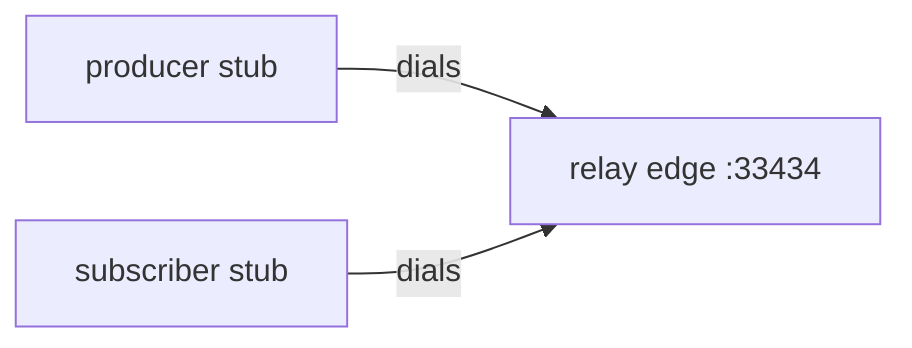
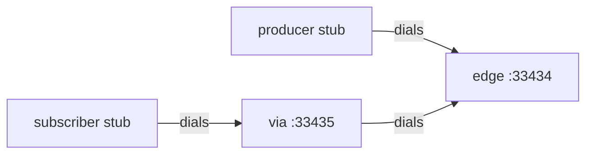

# Example programs

`examples/` builds three processes that speak the peering protocol to each other. They do not open a Media Over QUIC (MoQ) session. A real application, such as LAPS, implements MoQ and uses the same `PeerManager` and `Delegate` calls these programs use.

The library reference is [api.md](api.md). The wire protocol is [relay-protocol.md](relay-protocol.md).

| Binary | Source | Role |
| --- | --- | --- |
| `moq_peering_relay` | `examples/relay.cc` | Edge, via, or stub. Forwards announces, subscribes, and objects. |
| `moq_peering_producer` | `examples/producer.cc` | Stub that dials a relay, announces one track, and publishes datagrams when a peer subscribes. |
| `moq_peering_subscriber` | `examples/subscriber.cc` | Stub that dials a relay, subscribes to one track, and prints objects. |

Shared command-line parsing, certificate checks, and `Config` setup live in `examples/example_util.cc`.

## Build

```sh
cmake -S . -B build
cmake --build build --target moq_peering_relay moq_peering_producer moq_peering_subscriber
```

The binaries are `build/examples/moq_peering_relay`, `build/examples/moq_peering_producer`, and `build/examples/moq_peering_subscriber`. `make build` builds them together with the library and tests. `--help` or `-h` prints the flags for that binary.

## Certificates

Pass `--cert` and `--key`. Those are filesystem paths. The examples do not embed a certificate or a private key.

`make cert` writes a development pair under `build/`:

- `build/server-cert.pem`
- `build/server-key.pem`

That pair is a self-signed ECDSA P-256 certificate signed with SHA-256, valid for 365 days, with subject `CN=test.m10x.org`. It is for local runs of these examples. Inspect it before use:

```sh
openssl x509 -text -noout -in build/server-cert.pem
```

Each example reads the certificate before it constructs `PeerManager` and rejects the process when any of these are true:

- `notBefore` is still in the future, or `notAfter` is in the past
- the public key is RSA shorter than 2048 bits, or an EC key shorter than 256 bits
- the signature digest is MD5 or SHA-1
- the private key does not match the certificate, or the key PEM is encrypted

A self-signed certificate is printed on stderr and accepted, because `make cert` produces one for development. Do not use that certificate for a public deployment. On POSIX, a key that is readable by group or others produces a warning. Restrict it to the user running the process.

The library loads the same paths into the QUIC stack and presents that certificate. It does not configure a trust anchor, so it does not validate the peer's certificate. Two processes can share this development pair and still connect. Each process still has to be given a certificate and key to present.

## One edge, one producer, one subscriber

Run each command in its own terminal. Ctrl-C or `SIGTERM` stops that process.

```sh
./build/examples/moq_peering_relay \
  --cert build/server-cert.pem --key build/server-key.pem \
  --listen 33434

./build/examples/moq_peering_producer \
  --cert build/server-cert.pem --key build/server-key.pem \
  --peer 127.0.0.1:33434

./build/examples/moq_peering_subscriber \
  --cert build/server-cert.pem --key build/server-key.pem \
  --peer 127.0.0.1:33434
```

The producer and subscriber use the default track `demo/object`. The subscriber log shows `received hello 1`, then `hello 2`, and so on, one line a second. The producer log shows `subscriber joined` and `sent datagram group N`. The relay log shows `track announced demo/object` and `subscribe demo/object`.



Start the processes in any order. An announce or a subscribe made before the QUIC session is up is stored and sent when the handshake finishes. Starting the subscriber before the producer still delivers objects once the producer announces and sees the subscribe.

## An edge, a via, and the same producer and subscriber

The via dials the edge. Point the subscriber at the via. The producer can dial either relay. This layout sends the subscriber through the via:

```sh
./build/examples/moq_peering_relay \
  --cert build/server-cert.pem --key build/server-key.pem \
  --type edge --listen 33434 --node-id edge

./build/examples/moq_peering_relay \
  --cert build/server-cert.pem --key build/server-key.pem \
  --type via --listen 33435 --peer 127.0.0.1:33434 --node-id via

./build/examples/moq_peering_producer \
  --cert build/server-cert.pem --key build/server-key.pem \
  --peer 127.0.0.1:33434 --listen 33450

./build/examples/moq_peering_subscriber \
  --cert build/server-cert.pem --key build/server-key.pem \
  --peer 127.0.0.1:33435 --listen 33451
```



Give every process a distinct `--listen` port and a distinct `--node-id`. The numeric node id is the hash of that string. Two nodes with the same label look like the same relay.

The via log shows the announce and the subscribe. It does not print `received`, because a relay does not subscribe. Objects are forwarded by the library.

## A stub relay

`--type stub` on `moq_peering_relay` advertises `NodeType::kStub` and dials the peers you pass. In the protocol, a stub is a child of an edge: it dials that edge, and other relays dial the edge. The producer and subscriber binaries are stubs in that sense. They dial the relay, and the relay is not given their listen port.

`PeerManager` binds `listen_port` for every node type, including a stub. These examples still listen. Leave the producer and subscriber ports undialed.

## moq_peering_relay

Forwards peering state. It never calls `Announce`, `Subscribe`, or `SendData`.

```text
moq_peering_relay --cert FILE --key FILE [--node-id ID] [--type edge|via|stub]
                  [--listen PORT] [--peer HOST:PORT]...
```

| Flag | Default | Meaning |
| --- | --- | --- |
| `--cert` | required | PEM certificate this process presents. |
| `--key` | required | Matching unencrypted PEM private key. |
| `--node-id` | `relay` | Contact label. Hashed as the node id. |
| `--type` | `edge` | `edge`, `via`, or `stub`. Sets `Config::node_type`. |
| `--listen` | `33434` | UDP port. Must be from 1 to 65535. |
| `--peer` | none | `host:port` to dial. Repeat for more than one peer. |

`--type` is only accepted by this binary.

| Type | What to run |
| --- | --- |
| `edge` | The usual listener. Producers, subscribers, vias, and stubs dial it. It can also dial with `--peer`. |
| `via` | Forwards between relays. Give it its own `--listen` port and `--peer` the edge or the next relay. |
| `stub` | Dial an edge with `--peer`. Other relays should dial that edge. |

An empty `--peer` list means this process only accepts connections. Repeat `--peer` to dial several relays.

### How the relay uses the API

`main` maps the flags onto `Config` and starts one `PeerManager`. Construction binds the UDP port and dials every peer. The delegate is registered after construction, then cleared before the manager is destroyed.

```cpp
moq::peering::PeerManager peers(config);
peers.SetDelegate(&app);
// run until SIGINT or SIGTERM
peers.SetDelegate(nullptr);
```

`RelayApp` implements `Delegate` only to log. The library forwards without those callbacks.

| Callback | What the relay prints |
| --- | --- |
| `OnPeerUp` | `peer up session <id>` after a handshake. |
| `OnPeerDown` | `peer down session <id>` when that session drops. |
| `OnPeerTrack` | `track announced` or `track withdrawn`, plus the namespace and name. |
| `OnPeerNamespace` | The same for a namespace-only announcement. |
| `OnPeerSubscribe` | `subscribe <track> hash <full-name hash>`. |
| `OnPeerUnsubscribe` | The hash, and whether some other peer still subscribes. |

`OnPeerData` is left at the empty default. A relay that does not call `Subscribe` has no local subscription, so object bytes are forwarded to other peers and are not delivered to this delegate.

`Config::node_type` is copied into the node information advertised on each session. The current library forwards announces, subscribes, and datagrams for `kEdge`, `kVia`, and `kStub` alike. The type tells peers the role. The protocol's rule that an edge rewrites a stub as itself, so the rest of the network never learns the stub, is described in [relay-protocol.md](relay-protocol.md) and is not what this binary does.

`check_interval_ms` is set to `2000`, the shortest interval the library accepts. Disconnected peers are dialed again on that interval. Shutdown waits about half of it for the check thread.

## moq_peering_producer

Dials one or more relays as `NodeType::kStub`, announces one track, and publishes a datagram when `OnPeerSubscribe` runs for that track. A background thread sends another datagram on each interval while any subscriber remains.

```text
moq_peering_producer --cert FILE --key FILE --peer HOST:PORT
                     [--node-id ID] [--listen PORT]
                     [--namespace TEXT] [--track TEXT]
                     [--interval-ms N] [--payload TEXT]
```

| Flag | Default | Meaning |
| --- | --- | --- |
| `--cert`, `--key` | required | Same certificate rules as the relay. |
| `--peer` | required | Relay `host:port`. Repeat to dial more than one. |
| `--node-id` | `producer` | Contact label. |
| `--listen` | `33450` | UDP port this process binds. Do not dial it from the relay. |
| `--namespace` | `demo` | One namespace tuple. |
| `--track` | `object` | Track name. Together with the namespace this is `demo/object`. |
| `--interval-ms` | `1000` | Delay between later objects. From 1 to 600000. |
| `--payload` | `hello` | Object text. A space and a sequence number are appended, so the first object is `hello 1`. |

`--type` is rejected. The node type is always `kStub`.

The subscriber must use the same `--namespace` and `--track`. A second producer of a different track can share the relay:

```sh
./build/examples/moq_peering_producer \
  --cert build/server-cert.pem --key build/server-key.pem \
  --peer 127.0.0.1:33434 --listen 33452 --node-id camera \
  --namespace room --track video --payload frame --interval-ms 40
```

### How the producer uses the API

The track is one namespace tuple plus a name. `HashTrack` is the full-name hash used later by `SendData` and by the subscribe callbacks.

```cpp
const auto track = MakeTrack(name_space, track_name); // name_space = {"demo"}, name = "object"
const auto track_hash = moq::peering::PeerManager::HashTrack(track);
```

Order in `main`:

1. Check the certificate files.
2. Construct `ProducerApp`. It remembers the track hash and starts no QUIC yet.
3. Construct `PeerManager`. This binds `--listen` and dials `--peer`.
4. `Attach` stores the manager pointer the callback will use.
5. Start the publish thread. It waits until a subscribe arrives.
6. `SetDelegate`.
7. `Announce(track, Announcement::kTrack)`.

`Announce` records the track and sends it on sessions that are already up. A session that connects later receives the stored announce during handshake sync. That is why the producer can announce immediately after `SetDelegate`, including when the dial has not finished.

`OnPeerSubscribe` runs on a peering thread. The producer ignores any hash other than its own track. For its track it:

1. Stores `SubscribeParams::priority` when the subscriber sent a non-zero priority. Zero keeps the previous priority, which starts at 10.
2. Marks the track as wanted.
3. Schedules the next interval object one `--interval-ms` later. A second subscribe, while one is already active, does not push that deadline out.
4. Calls `SendData` once, outside the mutex.

```cpp
peers->SendData(track_hash,
                priority,
                /*ttl_ms=*/1000,
                moq::peering::DataType::kDatagram,
                /*group_id=*/sequence,
                /*subgroup_id=*/0,
                payload);
```

`payload` is `std::shared_ptr<const std::vector<uint8_t>>` holding `hello 1`, `hello 2`, and so on. The library adds the peering header. `group_id` is that sequence number. Datagram delivery does not use the group or subgroup to select a stream. `SendData` with no current subscriber does nothing.

`OnPeerUnsubscribe` clears the publishing flag only when `subscribers_remain` is false. One subscriber leaving while another remains keeps the interval loop running.

The interval loop waits until the deadline, then calls the same `SendData` path. It stops waiting when the last subscriber is gone or the process is stopping.

Callbacks and the interval thread share the manager pointer, the priority, and the sequence number under a mutex. `SendData` is called after that mutex is released. `PeerManager` methods are safe from the application thread and from a delegate callback. Holding the application's lock across `SendData` can deadlock if the library calls back into the delegate on the same thread.

Shutdown order matters because the interval thread calls `SendData`:

1. `SetDelegate(nullptr)` so new callbacks are not installed.
2. A guard declared after the `PeerManager` joins the interval thread while the manager is still alive.
3. The `PeerManager` destructor then closes sessions and joins the QUIC threads.
4. `ProducerApp`'s destructor joins the thread again if an exception destroyed the objects in a different order.

Do not destroy the manager or the delegate from inside `OnPeerSubscribe`.

## moq_peering_subscriber

Dials one or more relays as `NodeType::kStub`, subscribes to one track, and prints each object payload.

```text
moq_peering_subscriber --cert FILE --key FILE --peer HOST:PORT
                       [--node-id ID] [--listen PORT]
                       [--namespace TEXT] [--track TEXT]
```

| Flag | Default | Meaning |
| --- | --- | --- |
| `--cert`, `--key` | required | Same certificate rules as the relay. |
| `--peer` | required | Relay `host:port`. Repeat to dial more than one. |
| `--node-id` | `subscriber` | Contact label. |
| `--listen` | `33451` | UDP port this process binds. Do not dial it from the relay. |
| `--namespace` | `demo` | Must match the producer. |
| `--track` | `object` | Must match the producer. |

### How the subscriber uses the API

`Subscribe` is called once, from `main`, after `SetDelegate`. The parameters are fixed:

| Field | Value | Effect |
| --- | --- | --- |
| `priority` | `10` | Forwarded to the producer, which uses it on `SendData`. |
| `delivery_timeout_ms` | `1000` | Carried on the subscribe. |
| `forward` | `1` | Asks peers to forward objects. |
| `expires_ms` | unset | The subscribe stays until the process exits. |
| `new_group_request_id` | unset | The subscriber is not asking for a new group. |

```cpp
moq::peering::SubscribeParams params;
params.priority = 10;
params.delivery_timeout_ms = 1000;
params.forward = 1;
peers.Subscribe(track, params);
```

`Subscribe` records local interest and sends it to peers that are already connected. A later handshake sync sends the same subscribe. The local delegate is not called for this node's own subscribe. The producer receives `OnPeerSubscribe`.

`OnPeerData` runs only for a full-name hash this node has subscribed to. The subscriber compares that hash with `HashTrack` of `demo/object` and logs the payload bytes as text. For these datagrams, `is_new_stream` is false and `stream_id` is empty. Those arguments are unused here.

`OnPeerTrack` logs when the matching track is announced or withdrawn. The subscribe is already in place, so the callback does not call `Subscribe` again. `UpdateSubscribe` would be the call that changes parameters of an existing subscribe.

## What crosses the relay

With the producer and subscriber both dialing one edge, the library moves five kinds of information. The example logs are the application view of that path.

1. Each dial completes a QUIC handshake. `OnPeerUp` runs on the nodes that see the session. The relay's accepted session and the stub's outbound session are different session ids.
2. The producer's announce is synced to the edge. The edge calls `OnPeerTrack` and forwards the announce to its other peers. The subscriber calls `OnPeerTrack` and prints `track announced demo/object`.
3. The subscriber's `Subscribe` reaches the edge. The edge calls `OnPeerSubscribe`, forwards the subscribe, and the producer calls `OnPeerSubscribe`.
4. The producer `SendData` datagram follows the subscribe back. The edge forwards it. The subscriber's `OnPeerData` prints `received hello N`.
5. Further datagrams use the same path until the last subscriber is gone or a process stops.

A via in the middle is another forwarder on that path. It logs the announce and the subscribe. The producer and subscriber still talk only to the relay they dialed.

## Calls these examples leave alone

The binaries cover announce, subscribe, datagram `SendData`, and the delegate callbacks above. An application that implements MoQ also uses the rest of [api.md](api.md):

| Call | When an application uses it |
| --- | --- |
| `Withdraw` | The publisher stops advertising the track or namespace. |
| `UpdateSubscribe` | Priority, timeout, or forward changes for an existing subscribe. |
| `Unsubscribe` | This node no longer wants the track. |
| `HasSubscribers` | The publisher checks for peer interest without waiting for the next callback. The producer uses `OnPeerSubscribe` and `OnPeerUnsubscribe` instead. |
| `SendData` with `kNewStream` and `kExistingStream` | Objects that must arrive on one QUIC stream per `(group_id, subgroup_id)`. |
| `EndSubgroup` | Finish or reset that stream. |
| `Announcement::kNamespace` | Advertise a namespace that covers many tracks. The relay logs it through `OnPeerNamespace`. |

`kControlSignaling`, `kFetchNewStream`, and `kFetchExistingStream` are on `DataType` and are not selected by `SendData`.

## Failures you can hit while trying the binaries

| Message | Cause |
| --- | --- |
| `pass --cert and --key` | A required path was omitted. |
| `certificate file not found` or `private key file not found` | The path does not name a regular file. |
| `certificate is expired` or `certificate is not yet valid` | The validity dates failed the check. Renew the file. |
| `certificate is signed with MD5 or SHA-1` | The signature is not SHA-2. |
| `private key does not match the certificate` | `--key` is a different key, or the PEM is encrypted. |
| `pass --peer host:port` | The producer or subscriber has nobody to dial. |
| `picoquic network thread failed to bind` | `--listen` is already taken. Pick another port. |
| `Failed to resolve peering peer` | `--peer` host does not resolve. |
| `Failed to create picoquic context; check the certificate and key files` | The library could not load the pair. The example check normally reports the specific problem first. |

`Announce`, `Subscribe`, and `SendData` do not throw when the peer is not up yet or when nobody is subscribed. They update local state, or they do nothing, until a session and a subscribe exist.
